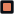
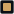
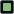
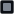

# Design

Colors come from the grammar. Semantic tokens only fix what the grammar cannot tell apart.

## Important

-   **Bold**: items that read like article headings in your code, at any depth: declarations of types, functions, methods, modules, macros, impl headers, named queries. Values stay regular: constants, fields, variables.
-   Orange-brown: control flow, as it needs extra attention: `return`, `break`, `continue`, `if`, `for … in`
-   _Italic ochre_: comments, as they carry important notes
-   Green: string literals and code in Markdown that you look for when debugging. Code inside a string, like a template expression, keeps its colors

## Regular

-   White (black): regular code, like variables, functions, return types, constants, and numbers

## Insignificant

-   Gray: pure syntax, like keywords, operators, punctuation, template delimiters, attributes and decorators. Also import path prefixes and types, except when used as a value, like `Option` in `-> Option<i64>` or `Some(x)`.
-   _Italic gray_: doc comments, like `/// Doc` and `"""docstrings"""`

Grammar gaps are fixed with injections in [vscode/syntaxes](vscode/syntaxes), scopes per language are in [vscode/src/theme.js](vscode/src/theme.js).
