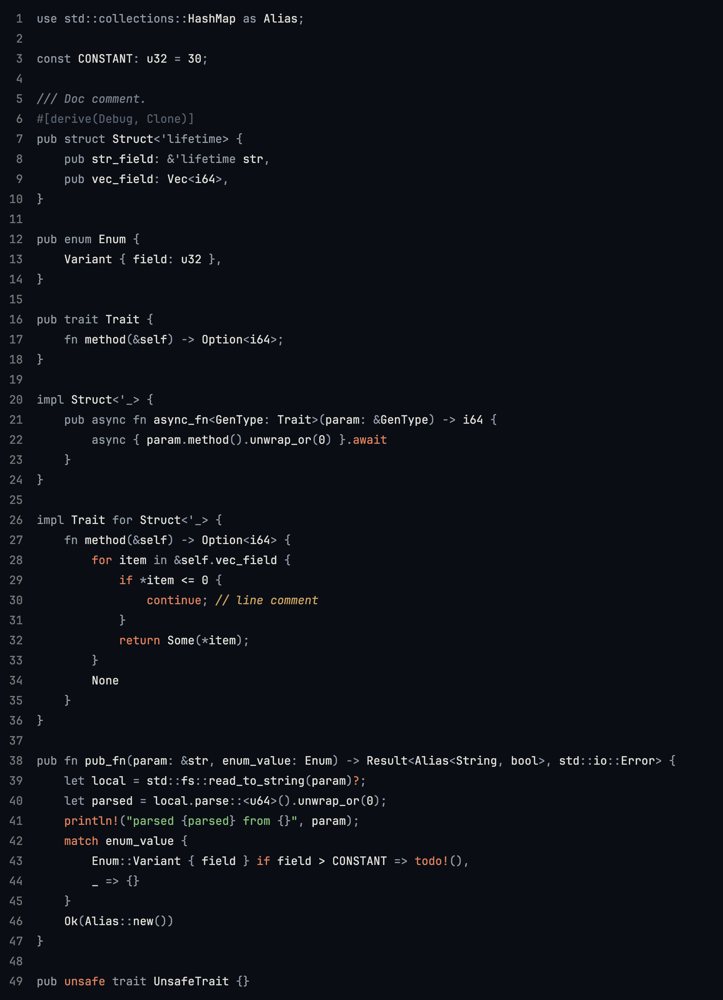
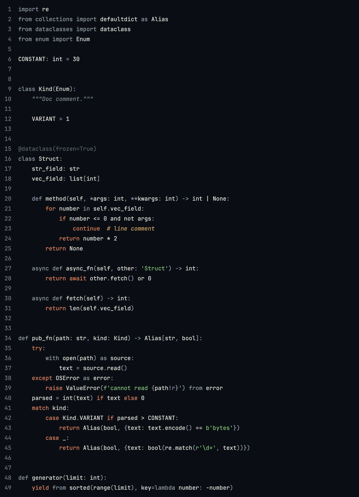

# Navigate

Color theme that helps you navigate through the code.

Most color schemes colorize syntax: keywords, expressions, operators. That doesn't help: you already know the syntax. What helps instead is dimming noisy boilerplate and highlight few important moments.

[Install in VSCode](https://marketplace.visualstudio.com/items?itemName=skatromb.navigate-theme)

| [Rust](sample/src/lib.rs) | [Python](sample/sample.py) |
| --- | --- |
|  |  |

[DESIGN.md](DESIGN.md) explains the colors. Panels are copied from [Pustota contrast](https://github.com/pustota-theme/pustota) (MIT, © Nikita Sobolev).
