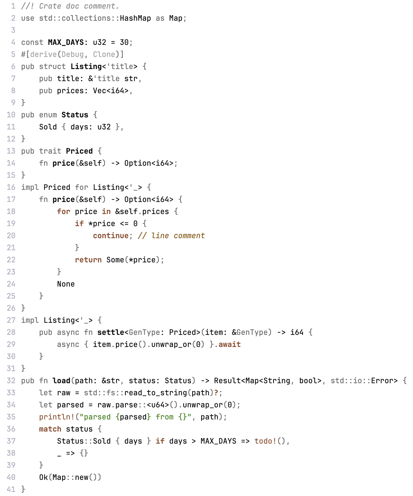

# Navigate

Color theme that helps you navigate through the code.

Most color schemes colorize syntax: keywords, expressions, operators. That doesn't help: you already know the syntax.

What helps instead is dimming noisy boilerplate and highlight few important moments.

## Important

-  Brown: control flow, `return`, `break`, `continue`, `if`, `match`, `for`, `.await`, `?`, `unsafe`, and macros, as they might hide control flow: `bail!`, `todo!`
-  _Italic ochre_: comments, as they carry important notes
-  Green: string literals that you read when debugging

## Regular

-  White: every name, variables, fields, functions, types, enum variants, `self`, `Self`, constants, numbers. Operators that compute: `+`, `-`, `==`, `&&`, `!`

## Insignificant

-  Gray: keywords `fn`, `let`, `pub`, `use`, `impl`, `mut`, `crate`, `super`, lifetimes, punctuation, operators that glue syntax: `::`, `.`, `->`, `=>`, `=`, `..`, `&`, `*`. Import path prefixes: `std::io::` in `use std::io::Error`
-  _Italic gray_: `/// Doc comments`
-  Light gray: `#[...]` attributes

## Installation

Navigate Dark for VS Code, panels are copied from [Pustota contrast](https://github.com/pustota-theme/pustota) (MIT, © Nikita Sobolev).

Install **Navigate** from the Extensions view in VS Code, then pick **Navigate Dark** in `Preferences: Color Theme`.
